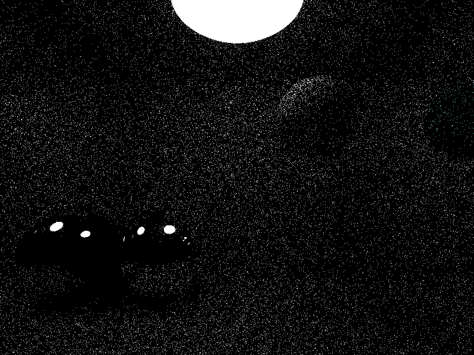

# PathTracerFS65

This is a path tracer program I wrote in 2023, before I began to use GitHub. The original `PathTracerFS65.cpp` file is unchanged from when I last updated it on September 4, 2023 (so excuse my comment on line 15).

This program renders a simple scene by simulating photon interactions with surfaces, with each intersection reflecting and accumulating colored light. The code is run entirely on a single CPU thread and the program stores the results for 1/10/50/100 photons per pixel, and displays the final result in a new window.

Here are the results, each image is 960x720 pixels, and every photon is capped at 4 bounces in the scene.

1 photon per pixel:

